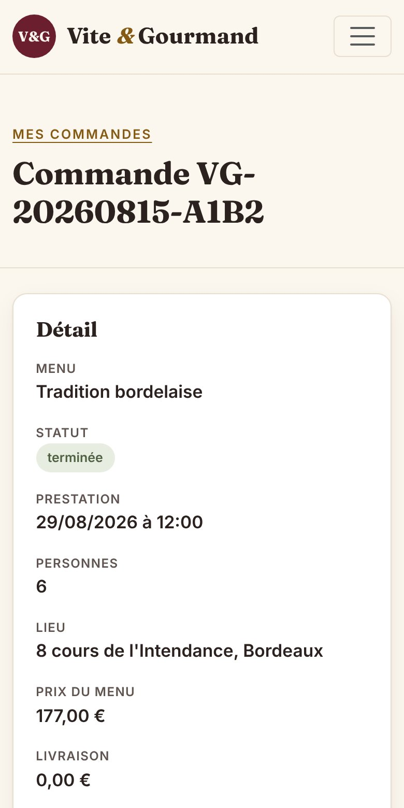
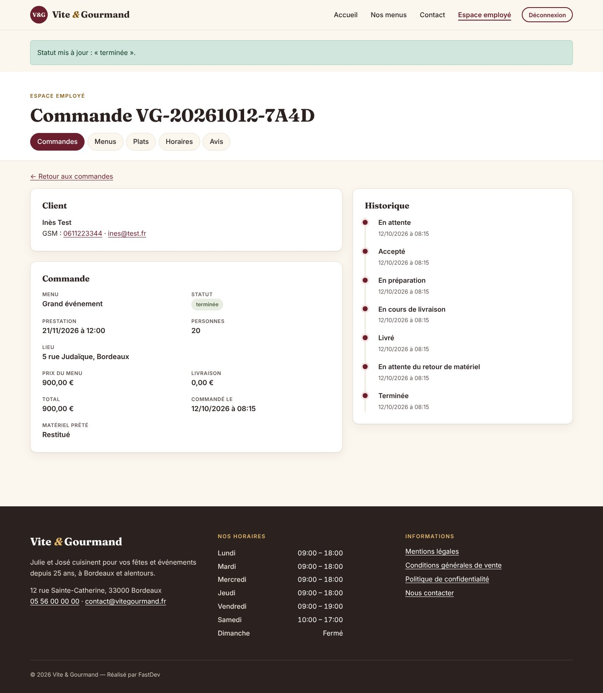
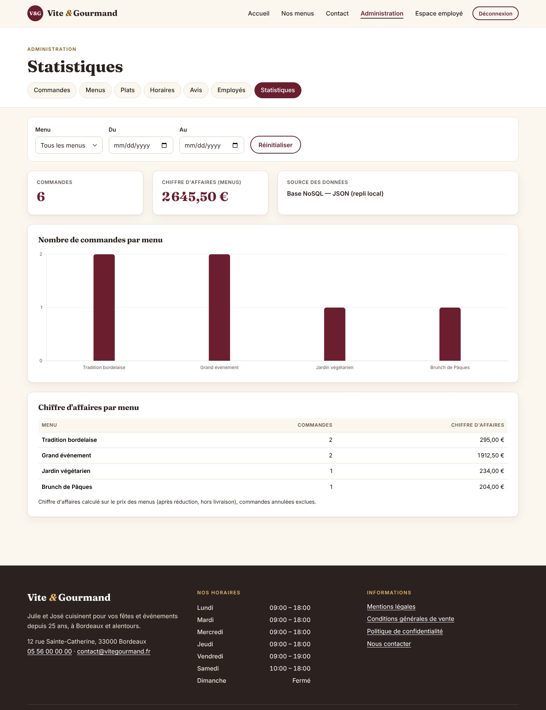

# Manuel d'utilisation

## 1. Présentation de l'application

**Vite & Gourmand** est l'application web du traiteur bordelais de Julie et José. Elle permet :

- aux **visiteurs** de découvrir l'entreprise, les avis clients et l'ensemble des menus, de les filtrer et de contacter l'entreprise ;
- aux **utilisateurs** (clients inscrits) de commander un menu, de suivre, modifier ou annuler leurs commandes et de déposer un avis ;
- aux **employés** de traiter les commandes, de gérer les menus, les plats, les horaires et de modérer les avis ;
- à l'**administrateur** (José) de faire tout ce que fait un employé, de gérer les comptes employés et de consulter les statistiques de commandes et le chiffre d'affaires.

L'application est responsive : elle s'utilise sur ordinateur, tablette et smartphone.

## 2. Identifiants de test

| Rôle | Identifiant (e-mail) | Mot de passe |
|---|---|---|
| Administrateur | jose@vitegourmand.fr | Admin!Gourmand2026 |
| Employée | julie@vitegourmand.fr | Employe!Gourmand2026 |
| Utilisateur | client@test.fr | Client!Gourmand2026 |
| Employé désactivé (démonstration) | ancien.employe@vitegourmand.fr | Employe!Gourmand2026 |

Vous pouvez aussi créer votre propre compte utilisateur depuis le bouton **Connexion → Créer un compte**.

## 3. Navigation générale

Le menu principal, présent sur toutes les pages, donne accès à :

- **Accueil** — présentation de l'entreprise, professionnalisme de l'équipe, menus du moment et avis validés ;
- **Nos menus** — vue globale de tous les menus ;
- **Contact** — formulaire de contact ;
- **Connexion** (ou **Mon espace / Espace employé / Administration** et **Déconnexion** une fois connecté).

Le pied de page affiche les **horaires du lundi au dimanche** ainsi que les liens vers les **mentions légales**, les **conditions générales de vente** et la **politique de confidentialité**.

Sur mobile, le menu est replié derrière le bouton « hamburger » en haut à droite.

## 4. Parcours visiteur

### 4.1 Consulter et filtrer les menus

1. Cliquez sur **Nos menus**.
2. Chaque carte présente le titre, la description, le nombre minimum de personnes et le prix pour ce minimum.
3. Utilisez les filtres à gauche : **prix maximum** ou **fourchette de prix**, **thème**, **régime**, **nombre de convives**. La liste se met à jour immédiatement, **sans rechargement de la page**, et le nombre de résultats est annoncé.
4. **Réinitialiser** efface tous les filtres.

### 4.2 Voir le détail d'un menu

Le bouton **Voir le détail** affiche la galerie d'images (cliquez sur une vignette pour l'agrandir), la composition (entrées, plats, desserts) avec les **allergènes** de chaque plat, le prix, le stock restant et, dans un encadré orange très visible, les **conditions du menu** (délai de commande, conservation, prêt de matériel).

### 4.3 Contacter l'entreprise

Page **Contact** : saisissez un titre, une description et votre e-mail. La demande est envoyée par e-mail à l'entreprise, qui vous répond à l'adresse indiquée.

## 5. Parcours utilisateur

### 5.1 Créer un compte

**Connexion → Créer un compte** : nom, prénom, GSM, e-mail, adresse postale, ville et un mot de passe sécurisé (**10 caractères minimum, avec une majuscule, une minuscule, un chiffre et un caractère spécial** — les règles se cochent en direct). Après validation, vous êtes connecté(e) avec le rôle « utilisateur » et recevez un **e-mail de bienvenue**.

### 5.2 Se connecter / mot de passe oublié

Saisissez votre e-mail et votre mot de passe. En cas d'oubli, **Mot de passe oublié ?** envoie un lien de réinitialisation valable 1 heure.

### 5.3 Commander un menu

1. Depuis le détail d'un menu, cliquez sur **Commander ce menu** (si vous n'êtes pas connecté(e), l'application vous demande de vous connecter ou de créer un compte, puis vous ramène à la commande).
2. Vos nom, prénom, e-mail et GSM sont **pré-remplis** depuis votre compte.
3. Renseignez l'adresse, la ville, la date et l'heure de livraison. Hors Bordeaux, la **distance** est estimée automatiquement à partir de l'adresse (modifiable).
4. Le menu est déjà sélectionné ; choisissez le **nombre de personnes** (au moins le minimum du menu).
5. Le panneau **Détail du prix** se met à jour : prix du menu, **réduction de 10 %** dès 5 personnes de plus que le minimum, **livraison** (offerte à Bordeaux, sinon 5 € + 0,59 €/km) et total.
6. Cochez la case confirmant la lecture des conditions du menu puis **Valider ma commande**. Un **e-mail de confirmation** vous est envoyé.

### 5.4 Mon espace

- **Mes commandes** : liste de toutes vos commandes et leur statut ; **Détail** affiche toutes les informations.
- Tant que la commande est **« en attente »**, vous pouvez la **modifier** (tout sauf le menu) ou l'**annuler**.
- Dès qu'elle est **« acceptée »**, le **suivi** liste chaque étape avec la date et l'heure.
- Quand la commande est **« terminée »**, vous êtes invité(e) par e-mail à donner un **avis** : note de 1 à 5 et commentaire, publié sur l'accueil après validation.
- **Mes informations** : modification des coordonnées et du mot de passe.

{width=45%}

## 6. Parcours employé

Connectez-vous avec un compte employé : vous arrivez sur **Espace employé → Commandes**.

### 6.1 Gérer les commandes

- Les compteurs en haut donnent le nombre de commandes par statut (cliquables).
- Le **filtre** permet de retrouver les commandes par **statut** et/ou par **client** (nom, prénom ou e-mail).
- **Gérer** ouvre la commande : coordonnées du client (GSM et e-mail cliquables), détail et historique.
- **Mettre à jour le statut** : accepté → en préparation → en cours de livraison → livré → *en attente du retour de matériel* → terminée. Cochez « du matériel a été prêté » si nécessaire : le statut « en attente du retour de matériel » envoie automatiquement au client l'e-mail l'informant des **600 € de frais** sans restitution sous 10 jours ouvrés ; la commande ne peut être terminée qu'une fois le matériel **restitué**.
- **Modifier** ou **Annuler** une commande n'est possible qu'**après avoir contacté le client** : le mode de contact (GSM ou e-mail) et le motif sont obligatoires.

### 6.2 Menus, plats, horaires, avis

- **Menus** : créer, modifier (titre, description, conditions, thème, régime, minimum, prix, stock, visibilité, plats proposés, galerie d'images) ou supprimer un menu. Un menu déjà commandé est **désactivé** plutôt que supprimé pour conserver l'historique. Des régimes et thèmes peuvent être ajoutés.
- **Plats** : créer, modifier ou supprimer un plat (type, photo, allergènes). Un même plat peut figurer dans plusieurs menus.
- **Horaires** : modifier les horaires du lundi au dimanche (affichés dans le pied de page).
- **Avis** : **valider** un avis pour le publier sur l'accueil, ou le **refuser**.

## 7. Parcours administrateur

Le compte administrateur dispose de tout l'espace employé, plus :

- **Employés** : créer un compte employé (e-mail = identifiant + mot de passe). L'employé reçoit un e-mail l'informant de la création de son compte, **sans le mot de passe** : l'administrateur le lui communique en main propre. **Désactiver** rend le compte inutilisable (départ de l'entreprise) ; il peut être réactivé. Il est impossible de créer un administrateur depuis l'application.
- **Statistiques** : graphique comparant le **nombre de commandes par menu** et tableau du **chiffre d'affaires par menu**, filtrables par **menu** et par **période** (du… au…). Ces données proviennent de la **base NoSQL**.

## 8. Récapitulatif des parcours de test

| Parcours | Compte | Étapes |
|---|---|---|
| Découverte | aucun | Accueil → Nos menus → filtres → Voir le détail |
| Inscription et commande | nouveau compte | Créer un compte → Commander un menu → Mon espace → Modifier / Annuler |
| Suivi et avis | client@test.fr | Mon espace → commande VG-20260815-A1B2 (terminée, avis déjà déposé) |
| Traitement d'une commande | julie@vitegourmand.fr | Commandes → filtre « en attente » → Gérer → statuts successifs |
| Retour de matériel | julie@vitegourmand.fr | Commande VG-20260918-E5F6 → cocher « matériel restitué » → Terminée |
| Modération | julie@vitegourmand.fr | Avis → Valider / Refuser |
| Administration | jose@vitegourmand.fr | Employés → créer / désactiver → Statistiques → filtres |
