# Charte graphique

## 1. Intention

Vite & Gourmand est une petite maison bordelaise, artisanale et chaleureuse, qui travaille depuis 25 ans pour les grandes occasions. L'identité visuelle traduit trois idées :

- **la table de fête** : un bordeaux profond (le vin, la région), un fond crème (la nappe) et un ocre doré (le cannelé, la croûte d'un pain) ;
- **la confiance** : une interface claire, aérée et lisible, où les informations importantes (prix, conditions, allergènes) sont toujours visibles ;
- **l'accessibilité** : tous les couples texte / fond respectent le niveau AA du RGAA (contraste ≥ 4,5:1).

## 2. Palette de couleurs

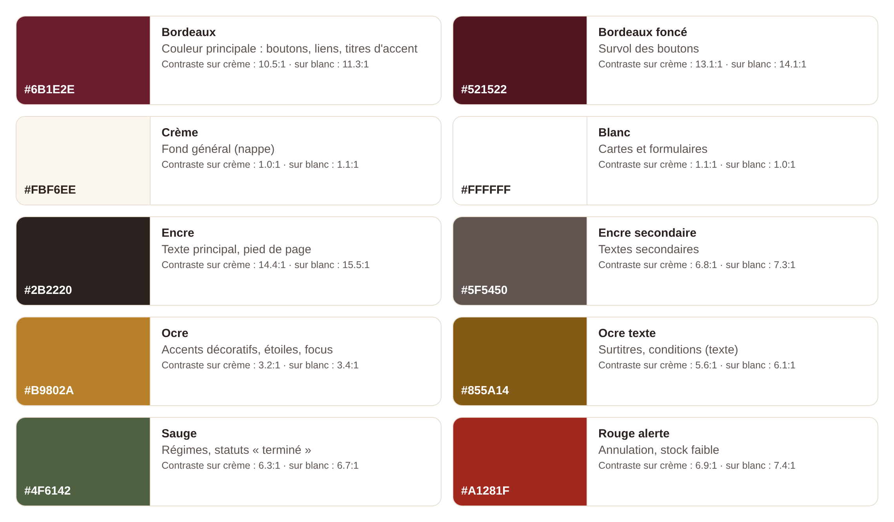

| Couleur | Code | Usage | Contraste |
|---|---|---|---|
| Bordeaux | #6B1E2E | Boutons, liens, accents | 11,4:1 avec du texte blanc |
| Bordeaux foncé | #521522 | Survol des boutons | 14,1:1 |
| Crème | #FBF6EE | Fond général | — |
| Blanc | #FFFFFF | Cartes, formulaires | — |
| Encre | #2B2220 | Texte principal | 14,4:1 sur crème |
| Encre secondaire | #5F5450 | Textes secondaires | 6,8:1 sur crème |
| Ocre | #B9802A | Décor, étoiles, contour de focus | 3,2:1 (éléments non textuels, seuil 3:1) |
| Ocre texte | #855A14 | Surtitres, encadré « conditions » | 5,6:1 sur crème |
| Sauge | #4F6142 | Régimes, statut « terminée » | 6,3:1 sur crème |
| Rouge alerte | #A1281F | Annulation, stock faible | 6,9:1 sur crème |

L'ocre décoratif n'est jamais utilisé pour du texte : une variante plus sombre (« ocre texte ») est réservée à cet usage. L'information n'est jamais portée par la couleur seule (statuts écrits en toutes lettres, étoiles accompagnées d'un texte « Note : 4 sur 5 »).

## 3. Typographie

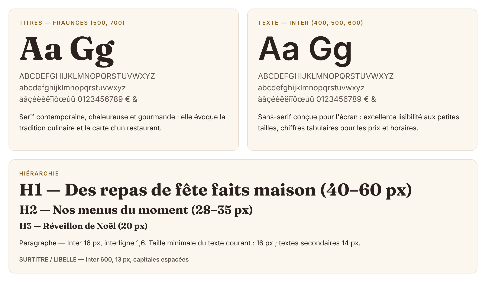

- **Fraunces** (Google Fonts, licence SIL OFL) — titres, en graisses 500 et 700 : une serif chaleureuse qui rappelle les cartes de restaurant.
- **Inter** (licence SIL OFL) — textes, formulaires et interface, en graisses 400, 500 et 600 : très lisible à l'écran, chiffres tabulaires pour les prix et les horaires.
- Les deux polices sont **auto-hébergées** (fichiers WOFF2 dans `public/assets/fonts`) : aucune requête vers les serveurs de Google, ce qui évite le transfert de l'adresse IP des visiteurs hors UE (RGPD) et accélère l'affichage.
- Taille de base : 16 px, interligne 1,6. Les tailles de titre s'adaptent à l'écran (`clamp()`).

## 4. Composants

- **Boutons** : forme « pilule », bordeaux plein pour l'action principale, contour bordeaux pour l'action secondaire, rouge doux pour les actions destructrices (supprimer, annuler) avec confirmation.
- **Cartes de menu** : image 3:2, badge de thème, badge de régime (sauge), prix « à partir de » pour le minimum de personnes, bouton pleine largeur.
- **Encadré « Conditions du menu »** : fond ocre clair, bordure ocre de 2 px et icône d'alerte, placé à côté du bouton « Commander » et rappelé sur la page de commande, avec une case à cocher obligatoire — l'exigence « bien mettre en évidence les conditions » de l'énoncé.
- **Récapitulatif de prix** : panneau sombre (encre) qui contraste avec le formulaire et reste visible pendant la saisie.
- **Statuts de commande** : pastilles colorées *et* libellées (en attente, en cours, terminée, annulée, retour de matériel).
- **Focus clavier** : contour ocre de 3 px sur tous les éléments interactifs.

## 5. Maquettes

Les maquettes ont été conçues *mobile first* puis déclinées sur ordinateur. Les trois écrans retenus sont ceux du parcours principal : **accueil → vue globale des menus → commande**.

### 5.1 Wireframes — version bureau

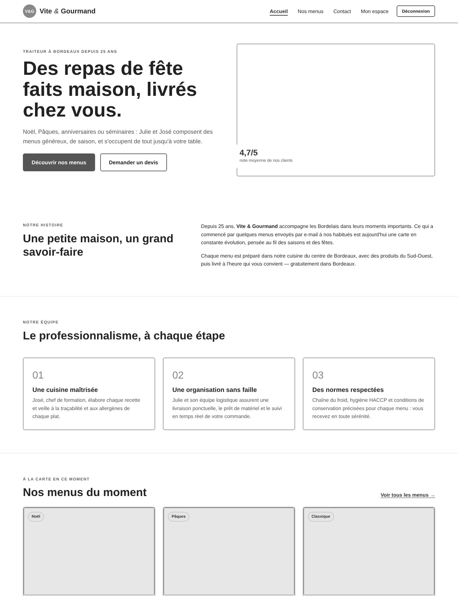

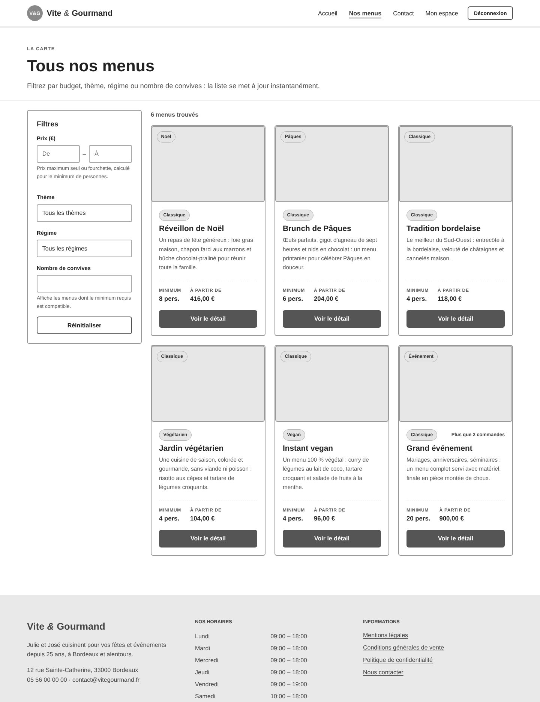

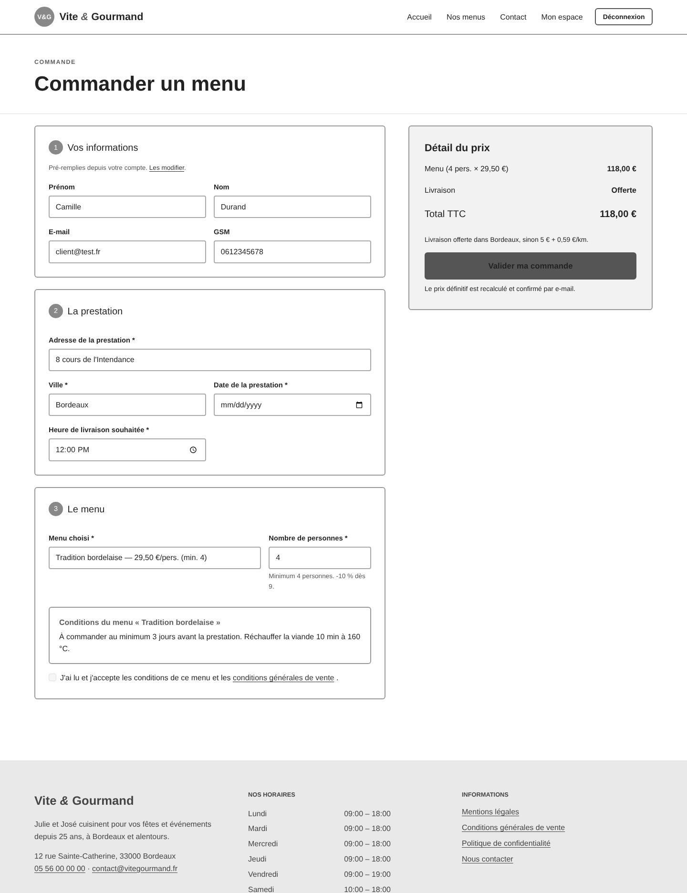

### 5.2 Wireframes — version mobile

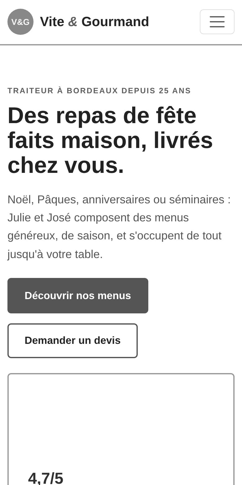{width=30%} 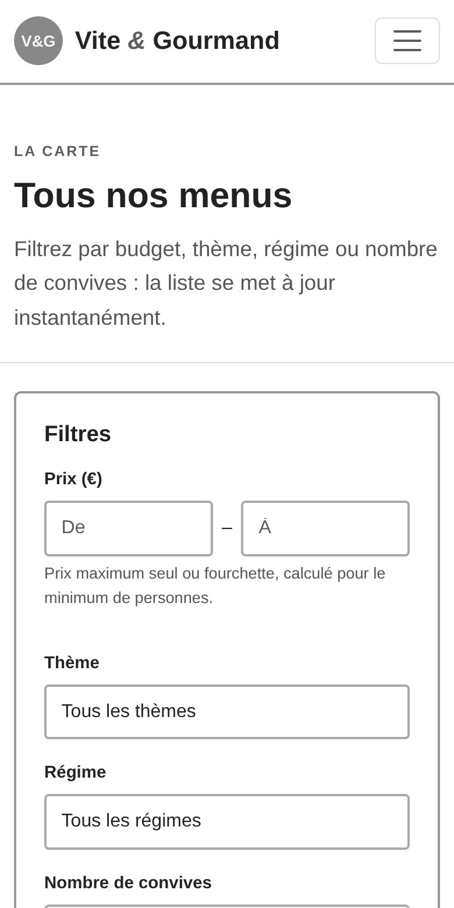{width=30%} 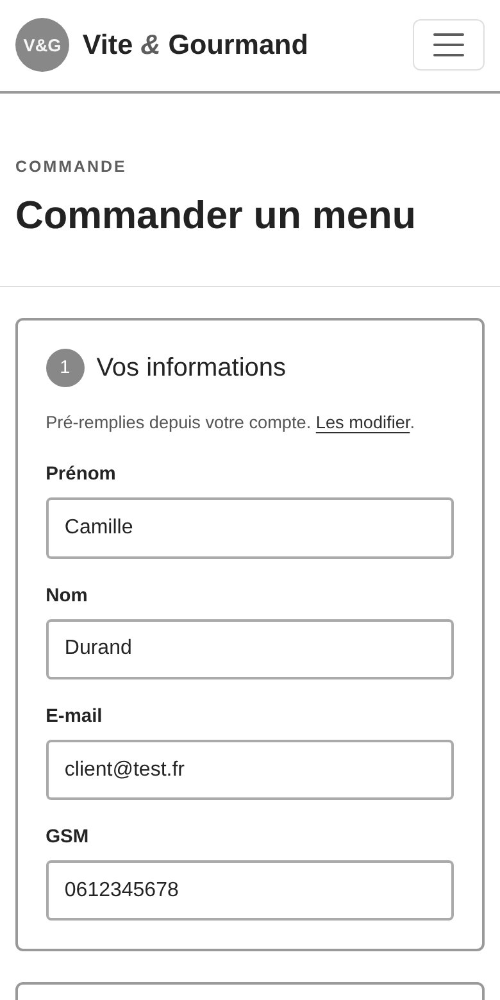{width=30%}

### 5.3 Mockups — version bureau

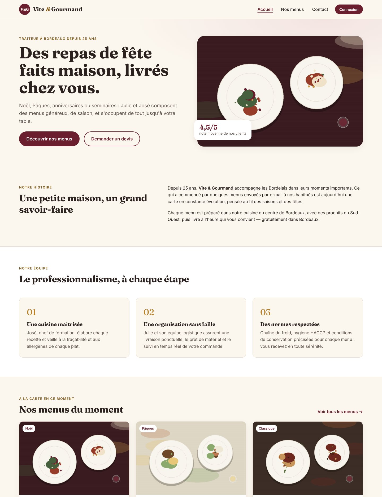

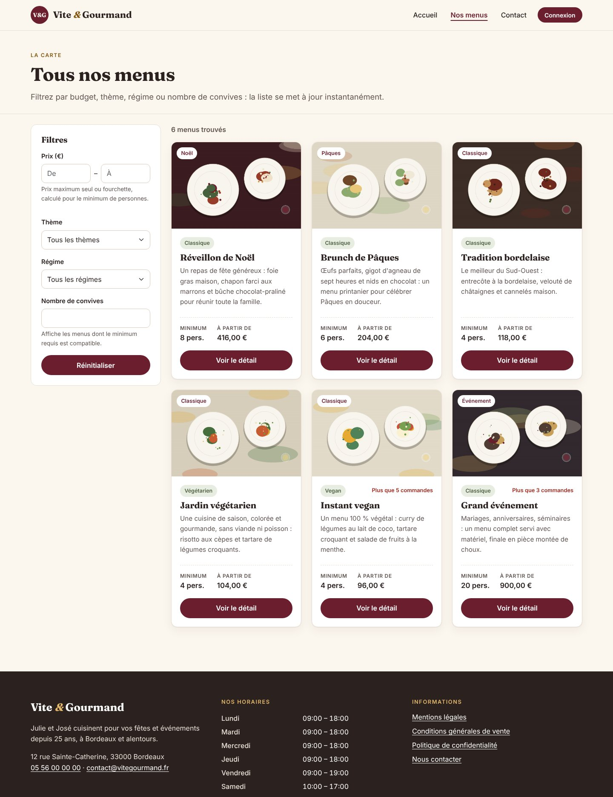

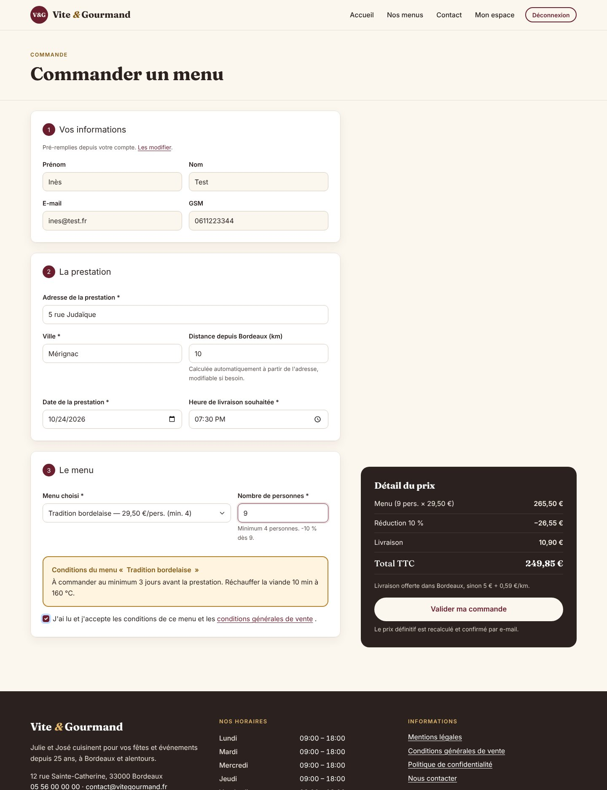

### 5.4 Mockups — version mobile

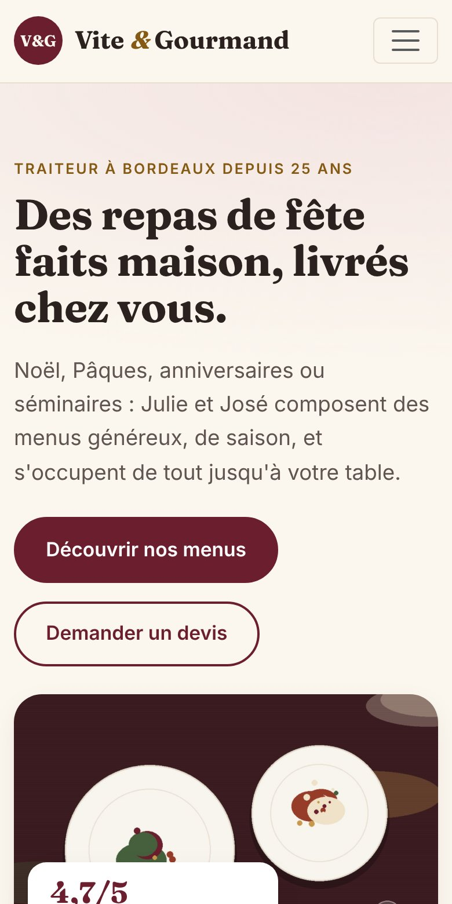{width=30%} 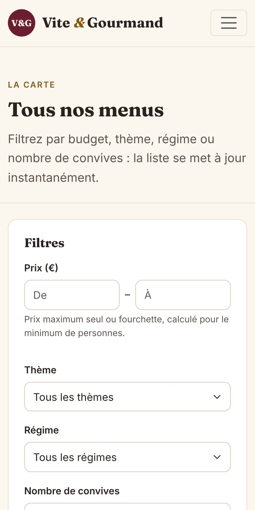{width=30%} 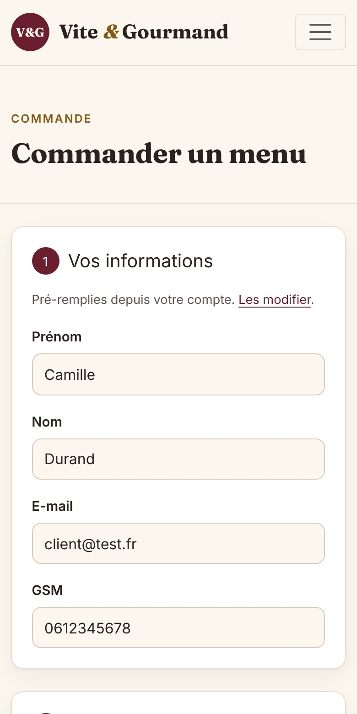{width=30%}
