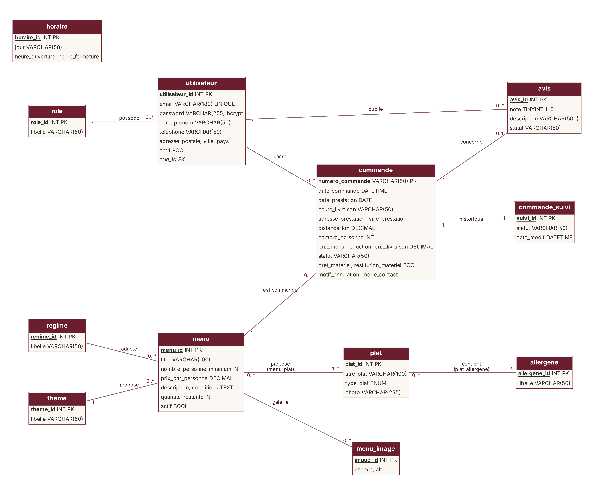
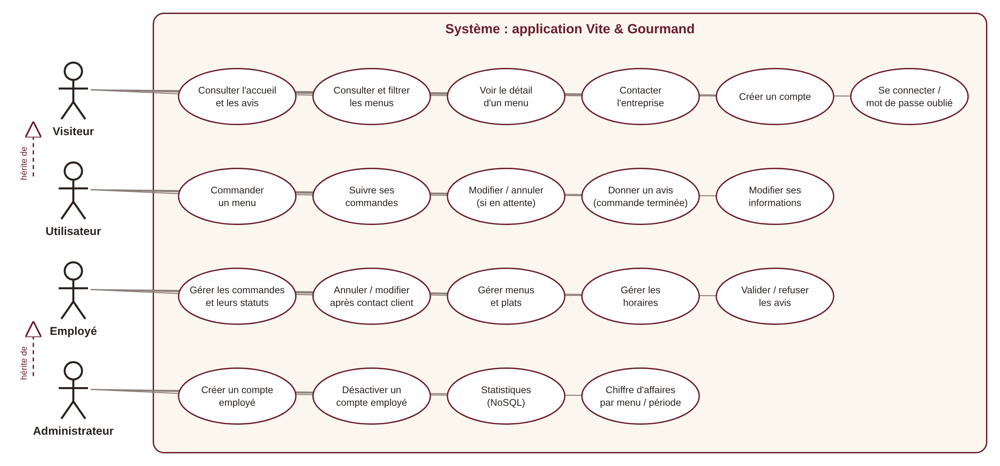
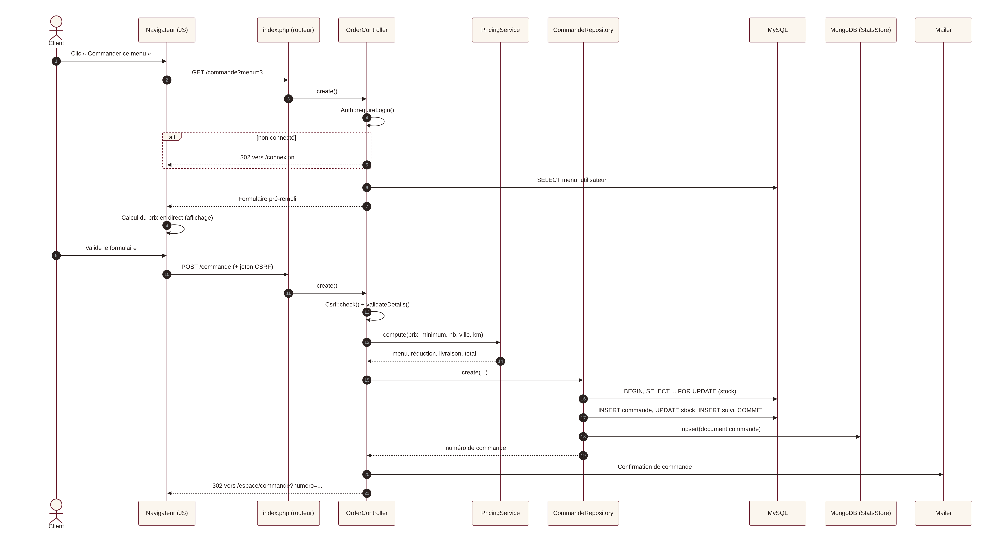

# Documentation technique

## 1. Réflexions initiales technologiques

### 1.1 Analyse du besoin

Julie et José n'ont aucune compétence informatique : l'application doit être **simple à administrer**, **peu coûteuse à héberger** et **maintenable** par une petite équipe. Le périmètre fonctionnel (catalogue filtrable, commande, suivi, back-office, statistiques) est celui d'une application de gestion classique, avec deux contraintes imposées : une **base relationnelle** et une **base non relationnelle**.

### 1.2 Choix retenus et justification

| Couche | Choix | Pourquoi | Alternatives étudiées |
|---|---|---|---|
| Front-end | HTML 5, CSS 3, **Bootstrap 5.3**, JavaScript natif | Rendu serveur rapide et bien référencé ; Bootstrap fournit une grille responsive et des composants accessibles ; JavaScript natif moderne (ES2020+ : modules `import`/`export`, classes, `const`/`let`, fonctions fléchées, template literals, `async`/`await` avec `fetch`) suffit pour les filtres dynamiques et le calcul de prix, sans chaîne de build | React / Vue : apport faible pour quelques interactions, ajout d'un build et d'une API complète ; Tailwind : nécessite un build |
| Back-end | **PHP 8.1+ sans framework**, architecture **MVC légère** (contrôleur frontal, contrôleurs, repositories, services, vues) | PHP est disponible chez tous les hébergeurs mutualisés ; sans framework, chaque mécanisme de sécurité (CSRF, sessions, hachage, requêtes préparées) est écrit et maîtrisé, ce qui est l'objectif de l'évaluation | Symfony : très robuste mais lourd pour ce périmètre ; Node.js/Express : excellent mais hébergement moins courant chez les petits clients |
| Accès aux données SQL | **PDO** avec requêtes préparées | Protection native contre l'injection SQL, transactions, indépendant du SGBD | ORM Doctrine : surdimensionné ici |
| Base relationnelle | **MySQL 8 / MariaDB** (InnoDB) | Respect du MCD fourni, intégrité référentielle (clés étrangères, contraintes `CHECK`), transactions pour le stock ; disponible partout | PostgreSQL : équivalent, moins répandu en mutualisé |
| Base NoSQL | **MongoDB** (Atlas en production) | Les statistiques sont des lectures agrégées : un document dénormalisé par commande (`menu_titre`, `montant`, `date`, `statut`) est idéal pour le pipeline `$match` / `$group` ; aucune jointure ; découplage des requêtes analytiques de la base transactionnelle | Redis : non adapté aux agrégations ; Firebase : verrouillage fournisseur |
| E-mails | **PHPMailer** (SMTP/TLS) + journal en développement | Envoi fiable et authentifié ; en local, les e-mails sont écrits dans `storage/logs/mail.log` pour être vérifiés sans serveur SMTP | `mail()` PHP : peu fiable, souvent bloqué |
| Graphiques | **Chart.js 4** | Léger, accessible (canvas avec libellé + tableau de données équivalent) | D3.js : plus complexe |
| Déploiement | **Docker + Fly.io**, MySQL managé, MongoDB Atlas | Image reproductible, HTTPS automatique, région Paris (`cdg`), offre gratuite / très faible coût | Heroku (payant), Vercel (pas de PHP natif), Azure (plus complexe) |

Les bibliothèques front (Bootstrap, Chart.js) et les polices sont **auto-hébergées** : pas de dépendance à un CDN, une politique CSP stricte (`'self'` uniquement) et aucun transfert de données personnelles vers des tiers.

### 1.3 Repli NoSQL en local

Pour que l'application fonctionne sur un poste sans MongoDB (XAMPP), la classe `StatsStore` expose une interface unique et choisit le moteur au démarrage : MongoDB si `MONGO_URI` est défini et l'extension présente, sinon un **magasin de documents JSON** (`storage/nosql/commandes.json`) qui applique la même logique d'agrégation. En production, la source affichée sur la page Statistiques est « MongoDB ».

## 2. Configuration de l'environnement de travail

| Outil | Version | Rôle |
|---|---|---|
| Visual Studio Code | 1.9x | Éditeur (extensions : PHP Intelephense, PHP Debug, MySQL, MongoDB for VS Code, Prettier, axe Accessibility Linter) |
| PHP | 8.3 (≥ 8.1) | Langage serveur, serveur de développement intégré `php -S` |
| MariaDB / MySQL | 10.11 / 8.0 | Base relationnelle (XAMPP possible) |
| MongoDB Community + mongosh | 7.x | Base NoSQL locale (facultatif grâce au repli JSON) |
| Composer | 2.x | Dépendances PHP (PHPMailer, mongodb/mongodb) |
| Git + GitHub | 2.4x | Versionnement (branches main / develop / feature) |
| Navigateurs | Chrome, Firefox, Safari | Tests, outils de développement, mode responsive |
| Figma | — | Wireframes et maquettes |
| Trello / Notion | — | Gestion de projet (Kanban) |
| Docker + flyctl | — | Conteneurisation et déploiement |
| Lighthouse, WAVE, NVDA | — | Audits accessibilité et performance |

Installation locale : voir le fichier `README.md` du dépôt (clonage, `composer install`, `.env`, import des scripts SQL, `php -S localhost:8000 -t public public/index.php`).

## 3. Architecture de l'application

```
Navigateur ──HTTP──▶ public/index.php (contrôleur frontal + routes)
                        │
                        ├─ src/Core        Env, Database (PDO), Auth, Csrf, View, Mailer, Upload
                        ├─ src/Controller  Home, Menu, Auth, Order, Account, Staff, Admin, Contact, Page
                        ├─ src/Repository  User, Menu, Plat, Commande, Avis, Ref   ──▶ MySQL
                        ├─ src/Service     PricingService, OrderStatus, StatsStore ──▶ MongoDB
                        └─ templates/      layout + pages + partiels (échappement systématique)
```

- **Un seul point d'entrée** (`public/index.php`) : seul le dossier `public/` est exposé par le serveur web.
- Les **contrôleurs** valident les entrées, vérifient les droits et appellent les **repositories** (SQL) et **services** (règles métier).
- Les **règles de prix** sont centralisées dans `PricingService` et recalculées côté serveur ; le JavaScript ne fait qu'afficher une estimation.
- Les **API JSON** `/api/menus` (filtres) et `/api/statistiques` (graphique) alimentent les mises à jour sans rechargement.
- Le **front-end** est organisé en **modules ES** (`public/assets/js/`) : `utils.js` regroupe les outils partagés (formatage monétaire, création d'éléments DOM sécurisée, sérialisation des filtres), importés par `menus.js` (classe `MenuFilter`), `order.js` (classe `OrderEstimator`), `stats.js` (classe `StatsDashboard`) et `app.js` (classe `PasswordChecker`, galerie, confirmations). Les appels réseau utilisent `async`/`await`, avec `AbortController` pour annuler une requête de filtrage devenue obsolète.

## 4. Modèle conceptuel de données

Le modèle reprend fidèlement le MCD de l'annexe 1 (utilisateur, rôle, commande, menu, thème, régime, plat, allergène, avis, horaire) et le complète par les tables nécessaires aux règles de gestion :

- `menu_image` — la **galerie d'images** d'un menu ;
- `menu_plat` et `plat_allergene` — tables d'association des relations n,n *propose* et *contient* ;
- `commande_suivi` — l'**historique daté** des statuts affiché dans le suivi client ;
- `reinitialisation_mdp` — jetons de réinitialisation (stockés hachés en SHA-256, valables 1 h, usage unique) ;
- colonnes ajoutées : `utilisateur.nom` et `utilisateur.actif` (désactivation d'un employé), `commande.adresse/ville/distance/reduction/motif_annulation/mode_contact`, `menu.conditions/actif`.

Choix notables : `numero_commande` lisible (`VG-AAAAMMJJ-XXXX`) comme clé primaire ; montants en `DECIMAL` (pas de `DOUBLE`, pour éviter les erreurs d'arrondi monétaires) ; contraintes `CHECK` (note de 1 à 5, stock ≥ 0) ; photo des plats stockée comme **chemin de fichier** plutôt qu'en `BLOB`, pour alléger la base et laisser le serveur web et le cache navigateur servir les images.



**Modèle NoSQL** — collection `commandes` (MongoDB) : un document par commande, alimenté à chaque création, modification ou changement de statut ; index sur `numero` (unique) et `{menu_id, date_commande}` ; schéma validé par `$jsonSchema` (`database/03_mongo_init.js`).

## 5. Diagramme de cas d'utilisation



L'utilisateur hérite des cas du visiteur ; l'administrateur hérite de tous les cas de l'employé.

## 6. Diagramme de séquence — commande d'un menu



Points clés : redirection vers la connexion si le visiteur n'est pas authentifié ; vérification du jeton CSRF ; recalcul serveur du prix ; transaction avec verrouillage `SELECT … FOR UPDATE` pour ne jamais vendre un menu dont le stock est épuisé ; écriture du document NoSQL ; e-mail de confirmation.

## 7. Sécurité

| Menace | Mesure mise en place |
|---|---|
| Injection SQL | PDO, requêtes **préparées** exclusivement, `ATTR_EMULATE_PREPARES = false` ; filtres convertis en types (int / float) |
| XSS | Fonction `e()` (`htmlspecialchars`, `ENT_QUOTES`, UTF-8) sur toutes les sorties ; côté JS, insertion via `textContent` uniquement ; **Content-Security-Policy** stricte (`default-src 'self'`, aucun script en ligne) |
| CSRF | Jeton aléatoire de 256 bits par session, vérifié par `hash_equals` sur **tous** les formulaires POST (y compris la déconnexion) ; cookie `SameSite=Lax` |
| Vol de session | Cookie `HttpOnly`, `Secure` en HTTPS, `use_strict_mode`, `session_regenerate_id()` à la connexion |
| Mots de passe | Hachage **bcrypt** (coût 12) avec `password_hash` ; politique imposée côté serveur (10 caractères, majuscule, minuscule, chiffre, caractère spécial) ; jamais transmis par e-mail |
| Force brute | Verrouillage de 5 minutes après 5 échecs ; temps de réponse homogène même si l'e-mail n'existe pas |
| Énumération de comptes | Message identique pour « mot de passe oublié », que le compte existe ou non |
| Contrôle d'accès | `Auth::requireRole()` sur chaque action ; vérification de propriété des commandes (anti-IDOR) ; compte désactivé déconnecté immédiatement ; **création d'administrateur impossible** (rôle forcé côté serveur) |
| Téléversement | Type MIME réel vérifié (`finfo`), 2 Mo max, nom aléatoire, exécution de scripts interdite dans `uploads/` |
| Redirection ouverte | Après connexion, seules les URL internes sont acceptées |
| Spam | Champ « pot de miel » sur le formulaire de contact |
| Base de données | Utilisateur MySQL applicatif avec privilèges limités (`SELECT, INSERT, UPDATE, DELETE`) ; identifiants dans `.env`, exclu de Git |
| En-têtes HTTP | `X-Frame-Options: DENY`, `X-Content-Type-Options: nosniff`, `Referrer-Policy`, `Permissions-Policy`, HSTS en HTTPS ; `expose_php = Off` |
| Erreurs | En production, messages génériques et détail uniquement dans les journaux |

**RGPD** : minimisation des données collectées, consentement explicite à l'inscription, politique de confidentialité, droit de rectification depuis l'espace client, avis publiés avec prénom et initiale seulement, statistiques NoSQL sans donnée personnelle, aucun cookie tiers (seul le cookie de session strictement nécessaire est utilisé).

## 8. Accessibilité (RGAA 4.1)

- Langue déclarée (`lang="fr"`), titres de page uniques, hiérarchie de titres cohérente, structure `header / nav / main / footer`.
- **Lien d'évitement** « Aller au contenu principal », navigation complète au clavier, **focus visible** (contour de 3 px).
- Tous les champs ont un `label` associé ; groupes de champs dans des `fieldset / legend` ; champs obligatoires signalés en texte.
- Contrastes AA vérifiés (voir charte) ; l'information n'est jamais transmise par la couleur seule.
- Images : alternatives textuelles pertinentes ; images décoratives avec `alt=""`.
- Contenus dynamiques annoncés aux lecteurs d'écran (`aria-live` sur le nombre de résultats des filtres, sur le récapitulatif de prix et les messages) ; `aria-current` sur la page active ; `aria-pressed` sur les vignettes de la galerie.
- Tableaux avec `caption` et en-têtes `scope` ; graphique doublé d'un tableau de données.
- Respect de `prefers-reduced-motion` ; mise en page sans défilement horizontal jusqu'à 320 px.

## 9. Tests réalisés

Une recette automatisée de bout en bout (Playwright) couvre **44 vérifications** : filtres dynamiques, redirection du visiteur vers la connexion, politique de mot de passe, calcul du prix (réduction et livraison), modification et annulation par le client, refus d'accès entre rôles (403), annulation impossible sans contact client, workflow complet des statuts et du retour de matériel, e-mails envoyés, avis et modération, création et désactivation d'un employé, statistiques NoSQL et filtres, absence de défilement horizontal sur mobile. Toutes les vérifications sont au vert.

## 10. Documentation du déploiement

### 10.1 Démarche

L'application est **en ligne sur alwaysdata** (hébergement mutualisé, PHP 8.3, MariaDB) à l'adresse **https://elbraiki.alwaysdata.net** — procédure suivie détaillée en 10.4. Le dépôt fournit aussi un déploiement conteneurisé (image Docker PHP 8.3 + Apache sur Fly.io, MySQL managée, MongoDB Atlas) décrit ci-dessous.

### 10.2 Étapes

1. **Base relationnelle** — créer une base MySQL 8 managée (ex. Aiven, Railway ou PlanetScale-compatible), puis importer `database/01_schema.sql` (sans les deux premières lignes `DROP/CREATE DATABASE` si l'hébergeur impose le nom de base) et `database/02_data.sql`. Créer un utilisateur applicatif aux droits limités.
2. **Base NoSQL** — créer un cluster gratuit **MongoDB Atlas** (région Europe), un utilisateur, autoriser l'accès réseau, puis exécuter `mongosh "<URI>" database/03_mongo_init.js`.
3. **SMTP** — créer un compte d'envoi transactionnel (Brevo, Mailjet…) et récupérer les identifiants SMTP.
4. **Fly.io** — installer `flyctl`, se connecter (`fly auth login`), puis à la racine du projet :
   - `fly launch --no-deploy` (reprend `fly.toml`, région `cdg` Paris) ;
   - `fly secrets set DB_HOST=… DB_USER=… DB_PASS=… MONGO_URI=… MAIL_HOST=… MAIL_USER=… MAIL_PASS=… APP_URL=https://vite-gourmand.fly.dev` ;
   - `fly deploy` : construction de l'image (`Dockerfile` : extensions `pdo_mysql` et `mongodb`, `composer install --no-dev`, racine web sur `public/`, `mod_rewrite`) puis mise en ligne.
5. **Vérifications** — HTTPS forcé (`force_https`), page d'accueil, connexion avec chaque rôle, commande test, réception des e-mails, page Statistiques indiquant la source « MongoDB », en-têtes de sécurité (`curl -I`).
6. **Mises à jour** — merge de `develop` dans `main` après tests, puis `fly deploy` ; en cas de problème, `fly releases` et retour à la version précédente.

### 10.3 Points d'attention

- Les variables sensibles ne sont **jamais** dans le dépôt : `.env` est ignoré par Git, les secrets sont gérés par `fly secrets`.
- Le disque des machines Fly est éphémère : les images téléversées depuis le back-office doivent, en évolution, être stockées sur un stockage objet (S3 / Tigris). Les images du jeu de données sont incluses dans l'image.
- Alternative mutualisée (ex. alwaysdata, o2switch) : déposer les fichiers par Git/SFTP, pointer la racine du site sur `public/`, créer `.env`, importer les scripts SQL — l'application fonctionne sans Docker.

### 10.4 Mise en ligne effective (alwaysdata)

1. Compte alwaysdata (offre gratuite) ; base MariaDB `elbraiki_ecf` créée depuis l'interface d'administration.
2. Site de type PHP 8.3, répertoire racine `~/www/vite-gourmand/public/` : seul `public/` est exposé.
3. En SSH : `git clone` du dépôt GitHub dans `~/www`, puis création du fichier `.env` sur le serveur (`APP_ENV=prod`, identifiants MySQL) — jamais versionné.
4. Import de `01_schema.sql`, `02_data.sql` et `04_photos.sql` (lignes `CREATE DATABASE` / `USE` retirées : le nom de base est imposé par l'hébergeur).
5. `php bin/sync-nosql.php` : initialisation de la base NoSQL en repli JSON (MongoDB n'est pas proposé par l'hébergeur).
6. Vérifications : HTTPS, accueil, filtres, commande, espaces utilisateur, employé et administrateur.
7. Mises à jour : merge de `develop` dans `main`, puis `git pull` dans `~/www/vite-gourmand`.
